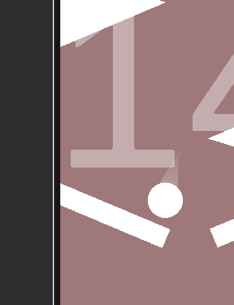
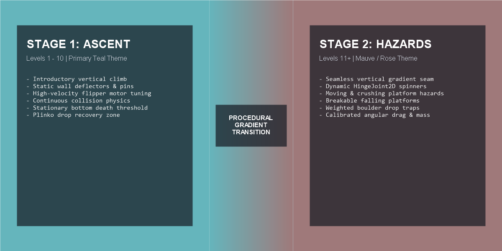
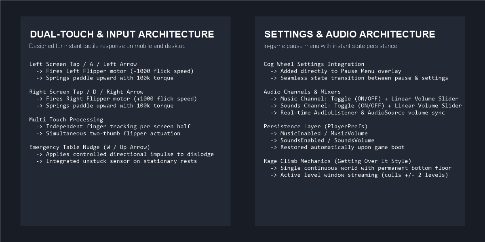

# PinUp - Physics Vertical Flipper Platformer

A physics-driven vertical climber built with Unity 2D and C#. PinUp combines high-speed pinball mechanics with the high-stakes vertical climb structure of precision rage games such as *Getting Over It*. Players navigate an ascending gauntlet of dynamic obstacles, rotating crossbars, and collapsing platforms using motor-driven dual flippers.

---

## Overview

In PinUp, progression is earned one level at a time. The player launches a weighted pinball upward through successive obstacle chambers. Missing a flipper hit or mistiming a shot can result in the ball dropping through previous levels back toward the base, creating an intense risk-and-reward gameplay loop.

The game features dynamic stage streaming, procedural color transitions between game stages, continuous collision physics, and responsive multi-touch controls for mobile and desktop platforms.

---

## Visual Showcase

### Gameplay in Action

*High-altitude climb in Stage 2 showing the player ball, flipper motor actuation, and stage number indicators.*

---

### Stage Progression & Procedural Gradient Transition

*Architectural comparison between Stage 1 (Teal theme) and Stage 2 (Mauve theme), bridged by a runtime procedural gradient texture.*

---

### Controls & Input Architecture

*Independent multi-touch detection across screen halves with instant torque actuation and dedicated pause/settings UI.*

---

### Plinko Recovery & Bottom Zone

*Stationary bottom safety zone featuring life triggers, retry pads, and ad reward zones.*

---

## Core Gameplay Features

### 1. Vertical Rage-Climb Progression
- Continuous vertical climb with no arbitrary level-load interruptions.
- A stationary death plane at the bottom of the world enforces full accountability for failed shots.
- Dropping out of high stages challenges the player to recover momentum or fight their way back up from earlier levels.

### 2. Dual-Touch Flipper Mechanics
- Powered by high-torque `HingeJoint2D` motors running at 100,000 maximum torque with customizable flick (-1000 to +1000) and return speeds.
- Multi-touch screen partition: tapping the left half activates the left flipper; tapping the right half activates the right flipper.
- Full keyboard (A/D, Arrow keys, Space) and mouse button support.

### 3. Stage Progression & Seamless Gradient Transitions
- **Stage 1 (Levels 1 - 10)**: Fast-paced ascent featuring static deflectors, calibrated bounce walls, and beginner-friendly hazards set against a clean teal palette (`#65B5BC`).
- **Stage 2 (Levels 11+)**: Elevated difficulty introducing dynamic spinning obstacles, moving crushers, breakable falling platforms, and falling boulder traps set against a warm mauve palette (`#9F797A`).
- **Procedural Transition**: A smoothstep vertical gradient texture is generated and applied to the transition chamber, eliminating visual seams between stage color themes.

### 4. Active Window Streaming & Performance Culling
- Endless climbing poses memory and physics computation challenges if every level remains active.
- PinUp implements a dynamic active window streaming system: only levels within a configurable radius (`+/- 2` levels) of the ball and camera remain active in memory and physics simulation.
- Distant stages are automatically culled, maintaining consistent 60+ FPS on mobile devices.

### 5. Calibrated Physics & Weight Balancing
- Player ball mass is calibrated at `0.3` mass with continuous collision detection and custom trailing rendering.
- Dynamic spinning obstacles operate with increased mass (`0.18`) and angular drag (`0.15`), giving them physical inertia when struck by the ball.
- Movable hazards (falling platforms and dropping boulders) interact solidly with flippers during gameplay while respecting short transition phase windows.

### 6. Pause & Settings Menu
- In-game pause overlay accessible via the top-right cog icon or Escape/P keys.
- Real-time audio settings with separate Music and Sound effect toggles and linear volume sliders.
- Automatic persistence via `PlayerPrefs` ensuring preferences survive application restarts.

---

## Controls Reference

| Action | PC / Keyboard | Mouse | Mobile / Touch |
| :--- | :--- | :--- | :--- |
| Left Flipper | Left Arrow / A / Space | Left Click (Left Half) | Tap Left Screen Half |
| Right Flipper | Right Arrow / D / Space | Left Click (Right Half) | Tap Right Screen Half |
| Table Nudge | Up Arrow / W | - | Nudge Action |
| Pause / Resume | Escape / P | Top-Right Button | Tap Pause Icon |
| Quick Restart | R | Retry Button | Tap Retry Button |

---

## Technical Architecture

```
PinUp-Showcase/
├── screenshots/
│   ├── gameplay-flipper-climb.png
│   ├── stage-progression-overview.png
│   ├── controls-and-architecture.png
│   └── plinko-recovery-zone.png
└── README.md
```

### Tech Stack
- **Game Engine**: Unity 2022.3 LTS
- **Scripting Language**: C# 9.0 (.NET Standard 2.1)
- **Physics**: Unity 2D Physics (`Rigidbody2D`, `HingeJoint2D`, `CircleCollider2D`, `BoxCollider2D`)
- **Rendering**: Universal 2D Sprite Renderer with runtime procedural gradient generation
- **UI Framework**: Unity UI (uGUI) with Canvas Scaler

---

## Repository Links

- **Private Development Repository**: `https://github.com/kevnevv/PinUp` (Full project source, Unity scenes, assets, and project settings)
- **Public Showcase Repository**: `https://github.com/kevnevv/PinUp-Showcase` (Showcase documentation and media assets)

---

## License

This showcase repository and its documentation are distributed under the MIT License. Game design, original artwork, and codebase are copyright KevNev.
